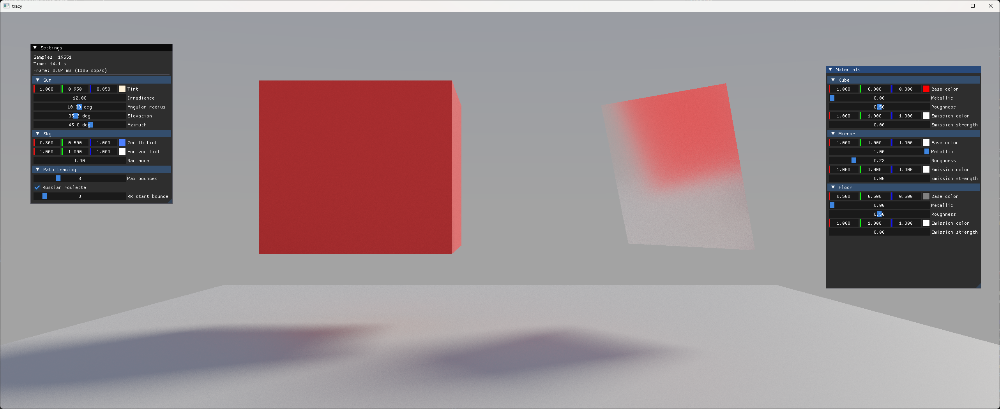

# tracy

A small, hobby GPU path tracer built on Direct3D 12 inline ray tracing (DXR 1.1 `RayQuery` in a compute shader) and [wand](https://github.com/leopph/wand), a thin D3D12 wrapper library.



## Features

- Progressive path tracing with accumulation, exposure and AgX tonemapping
- Metal/roughness GGX BRDF with VNDF importance sampling and cosine-weighted diffuse sampling
- Analytic sky and sun disk
- Russian roulette path termination
- Live-editable sun, sky, material and path tracing settings through Dear ImGui

## Building

Requirements:

- Windows 10/11 with a GPU that supports DXR 1.1 and Shader Model 6.6
- Visual Studio 2026 (MSVC v145 toolset, C++23)

```
git clone --recursive https://github.com/leopph/tracy.git
cd tracy
vcpkg\bootstrap-vcpkg.bat
```

Then open `tracy.sln` and build the `x64` Debug or Release configuration. Dependencies (Dear ImGui, DirectXMath) are installed through vcpkg manifest mode, and the D3D12 Agility SDK and DXC through NuGet, on the first build.
